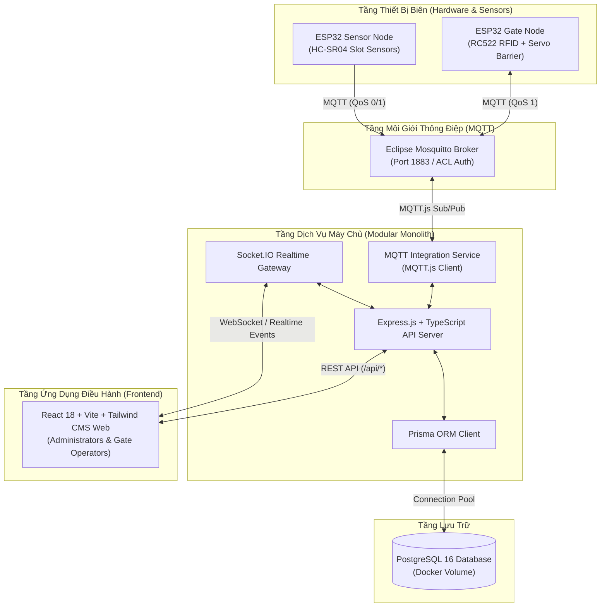

# TỔNG QUAN KIẾN TRÚC HỆ THỐNG SMART PARKING IOT (SYSTEM OVERVIEW)

---

## 1. MÔ HÌNH TỔNG THỂ (HIGH-LEVEL ARCHITECTURE)

Hệ thống được thiết kế theo mô hình **Modular Monolith (Đơn khối phân tầng)** nhằm tối ưu hóa tính tinh gọn, dễ bảo trì, dễ kiểm thử và đáp ứng tiến độ hoàn thành trong 2–3 tuần của đồ án đại học.

---

## 2. PHÂN TÍCH CÁC THÀNH PHẦN KIẾN TRÚC

### 2.1. Tầng Thiết Bị Biên (ESP32 Nodes)
- **Gate Node**: Phụ trách nhận tín hiệu quét thẻ RFID, gửi sự kiện `RFID_SCANNED` lên MQTT Broker, nhận lệnh `GATE_COMMAND` từ Backend để mở barrier và ghi nhận sự kiện `VEHICLE_PASSED`.
- **Sensor Node**: Đo khoảng cách tại từng vị trí đỗ, phát hiện sự thay đổi trạng thái có/không có xe và xuất bản sự kiện `SENSOR_CHANGED`.

### 2.2. Tầng Môi Giới Thông Điệp (Eclipse Mosquitto)
- Đóng gói trong Docker container độc lập, lắng nghe cổng 1883.
- Cơ chế bảo mật: Cấm kết nối nặc danh (`allow_anonymous false`), bắt buộc xác thực user/password và phân quyền truy cập thông qua ACL scoped `smartparking/#`.

### 2.3. Tầng Dịch Vụ Máy Chủ (Node.js + Express + TypeScript)
- **Tách biệt Bootstrap**:
  - `app.ts`: Khởi tạo và thiết lập các middleware của Express (CORS, JSON parser, Request logger, Error handling). Phục vụ test tự động độc lập qua `supertest`.
  - `server.ts`: Điểm khởi chạy HTTP Server, khởi tạo Socket.IO, kết nối nền MQTT Client và Prisma ORM, tích hợp xử lý Graceful Shutdown (`SIGINT`, `SIGTERM`).
- **Xác thực cấu hình (Fail-Fast Environment Validation)**: Sử dụng Zod để kiểm tra toàn bộ biến môi trường ngay lúc khởi động.
- **Hợp đồng API nhất quán**:
  - Thành công: `{ "success": true, "data": ... }`
  - Thất bại: `{ "success": false, "error": { "code": "...", "message": "..." } }`

### 2.4. Tầng Dữ Liệu (PostgreSQL & Prisma ORM)
- Quản trị quan hệ dữ liệu có cấu trúc, đảm bảo tính toàn vẹn (ACID) cho các giao dịch quẹt thẻ và tính phí.
- Phiên bản ban đầu (Pha 0) triển khai bảng kiểm tra xác thực `database_verifications` và cấu trúc dự lưu `users`.

### 2.5. Tầng Giao Diện Điều Hành (React CMS Web)
- Xây dựng bằng React 18, Vite, TypeScript, Tailwind CSS, Lucide icons và TanStack Query.
- Dùng chung giao diện cho Quản trị viên và Nhân viên trực cổng.
- Không đưa vào dữ liệu giả lập (mock data); tích hợp widget theo dõi trạng thái sức khỏe máy chủ thời gian thực qua endpoint `/api/health`.

---

## 3. TẠI SAO CHỌN MODULAR MONOLITH?

1. **Tiến độ hạn hẹp (2–3 tuần)**: Mô hình Microservices tạo ra gánh nặng lớn về quản lý mạng, phân tán cơ sở dữ liệu, deployment và đồng bộ giao thức. Modular Monolith cho phép phát triển với tốc độ tối đa.
2. **Không phụ thuộc hạ tầng thừa thãi**: Dự án không dùng Redis, Kafka, Kubernetes hoặc Firebase. Mọi luồng realtime được đảm nhiệm bởi Mosquitto (cho IoT) và Socket.IO (cho Web CMS).
3. **Dễ mở rộng sang Web/Mobile người dùng**: Cấu trúc REST API được thiết kế tái sử dụng, sẵn sàng phục vụ ứng dụng người dùng cuối trong tương lai.

