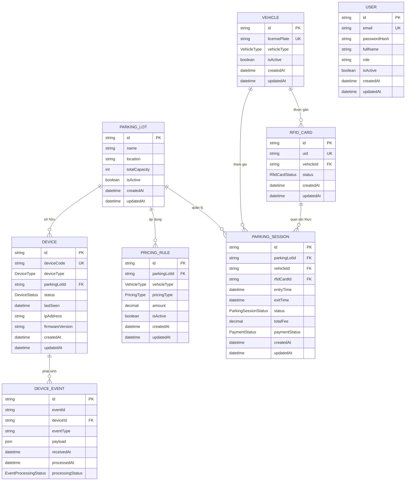

# SMART PARKING IOT — SPECIFICATION MÔ HÌNH THỰC THỂ CƠ SỞ DỮ LIỆU (PHASE 1 DOMAIN MODEL)

**Phân hệ**: Thiết kế Kiến trúc Dữ liệu Quan hệ (PostgreSQL & Prisma ORM)  
**Phiên bản Schema**: Phase 1 — v1.0.0  
**Tương thích**: PostgreSQL 16.x & Prisma ORM 6.x  

---

## 1. TỔNG QUAN THIẾT KẾ (DESIGN OVERVIEW)

Mô hình dữ liệu của hệ thống **Smart Parking IoT** được thiết kế dựa trên các nguyên tắc cốt lõi:
1. **Toàn vẹn và Bất biến dữ liệu (Data Integrity & Immutability)**:
   - Các bản ghi lịch sử hoạt động (`parking_sessions`, `device_events`) **không bao giờ bị xóa theo dạng cascade** (`onDelete: Restrict`).
   - Tiền tệ và thời gian gửi xe tuân thủ các ràng buộc kiểm tra cấp cơ sở dữ liệu (`CHECK (total_fee >= 0)`, `CHECK (amount >= 0)`).
2. **Ngăn chặn xung đột bằng Chỉ mục một phần (Partial Unique Indexes)**:
   - Một phương tiện chỉ được phép có **tối đa một phiên gửi xe đang hoạt động** (`ACTIVE`, `PENDING_ENTRY`, `PENDING_EXIT`) tại một thời điểm, ngăn chặn lỗi logic hai xe cùng biển số vào bãi.
   - Tương tự, một thẻ từ RFID chỉ được gắn với tối đa một phiên đỗ xe đang hoạt động.
3. **Hỗ trợ xử lý thông điệp MQTT bất đồng bộ và chống lặp (Idempotent Event Ingestion)**:
   - Bảng `device_events` sở hữu khóa duy nhất tổ hợp `(deviceId, eventId)` bảo đảm mỗi sự kiện biên từ ESP32 chỉ được xử lý đúng một lần, loại trừ triệt để nguy cơ duplicate bản tin khi truyền thông qua MQTT QoS 1.

---

## 2. SƠ ĐỒ THỰC THỂ QUAN HỆ (MERMAID ERD)

---

## 3. CHI TIẾT CÁC THỰC THỂ (ENTITY SPECIFICATIONS)

### 3.1. `User` (Tài khoản người dùng CMS)
- **Mục đích**: Lưu thông tin nhân viên trực cổng hoặc quản trị viên điều hành CMS.
- **Ràng buộc**: `email` là duy nhất (`UNIQUE`).
- **Lưu ý**: Giữ nguyên trường `role` từ Phase 0 để đảm bảo khả năng tương thích ngược của cơ sở dữ liệu.

### 3.2. `ParkingLot` (Bãi đỗ xe vật lý)
- **Mục đích**: Quản lý thông số tổng quan của bãi xe (MVP hỗ trợ 1 bãi đỗ; thiết kế sẵn sàng cho chuỗi bãi xe trong tương lai).
- **Trường chính**: `name`, `location`, `totalCapacity` (sức chứa tối đa để tính số chỗ trống).

### 3.3. `Vehicle` (Phương tiện)
- **Mục đích**: Quản lý phương tiện đăng ký (xe tháng/cư dân/giảng viên) hoặc xe vãng lai.
- **Ràng buộc**: `licensePlate` là duy nhất (`UNIQUE`), chuẩn hóa chữ in hoa không khoảng trắng.
- **Phân loại**: Enum `VehicleType` gồm `CAR` (ô tô) và `MOTORBIKE` (xe máy).

### 3.4. `RFIDCard` (Thẻ từ RFID Mifare RC522)
- **Mục đích**: Định danh thẻ từ vật lý do thiết bị biên quét được.
- **Ràng buộc**: `uid` là duy nhất (`UNIQUE`), chuẩn hóa chữ hoa.
- **Liên kết**: `vehicleId` là trường tùy chọn (nullable). Thẻ có thể gán cố định cho một phương tiện, hoặc để trống (dành cho thẻ vãng lai phát tại quầy).
- **Hành vi tham chiếu**: `onDelete: SetNull` (nếu xóa xe, thẻ trở về trạng thái chưa gán xe).

### 3.5. `ParkingSession` (Phiên gửi xe)
- **Mục đích**: Ghi nhận toàn bộ vòng đời xe ra vào, thời gian gửi và lịch sử tính tiền.
- **Trạng thái vòng đời**: Enum `ParkingSessionStatus`:
  - `PENDING_ENTRY`: Đã quẹt thẻ tại cổng vào, đang đợi cảm biến xác nhận xe vượt qua barrier.
  - `ACTIVE`: Xe đã vào bãi thành công, phiên đỗ đang tính thời gian.
  - `PENDING_EXIT`: Quẹt thẻ tại cổng ra, chờ thu ngân xác nhận hoặc thanh toán.
  - `COMPLETED`: Xe đã rời khỏi bãi, phiên đỗ hoàn tất.
  - `CANCELLED`: Phiên bị hủy (xe lùi lại không vào bãi).
- **Bảo toàn dữ liệu**:
  - `onDelete: Restrict` đối với `ParkingLot`, `Vehicle` và `RFIDCard`. Ngăn chặn hoàn toàn việc xóa nhầm các thực thể danh mục nếu chúng đã có lịch sử gửi xe.
- **Ràng buộc kiểm tra cấp PostgreSQL**:
  - `chk_parking_session_total_fee_non_negative`: `CHECK (total_fee >= 0)`.
- **Chỉ mục một phần (Partial Unique Indexes)**:
  - `unique_active_vehicle_session`: Ngăn một xe có 2 phiên đỗ cùng trạng thái `ACTIVE` / `PENDING_*`.
  - `unique_active_rfid_session`: Ngăn một thẻ RFID được dùng đồng thời cho 2 phiên đỗ chưa kết thúc.

### 3.6. `Device` (Thiết bị biên IoT ESP32)
- **Mục đích**: Đại diện cho các nút điều khiển phần cứng tại cổng (Gate Nodes).
- **Trường chính**: `deviceCode` (duy nhất, VD: `GATE_IN_01`), `deviceType` (`GATE_ENTRY`, `GATE_EXIT`, `SENSOR_NODE`), `status` (`ONLINE`, `OFFLINE`, `MAINTENANCE`), `lastSeen`, `firmwareVersion`.

### 3.7. `DeviceEvent` (Nhật ký sự kiện bất biến từ MQTT)
- **Mục đích**: Lưu trữ thô các bản tin nhận từ Broker (như `RFID_SCANNED`, `GATE_COMMAND`, `VEHICLE_PASSED`, `DEVICE_HEARTBEAT`).
- **Khóa duy nhất Idempotency**: `(deviceId, eventId)` là khóa tổ hợp duy nhất (`@@unique([deviceId, eventId])`). Khắc phục triệt để nguy cơ xử lý lặp lại bản tin khi broker gửi lại (QoS 1 retransmission).
- **Payload**: Lưu dưới dạng `Json` (PostgreSQL `JSONB`) cho phép truy vấn linh hoạt.

### 3.8. `PricingRule` (Cấu hình biểu giá gửi xe)
- **Mục đích**: Lưu đơn giá gửi xe theo loại phương tiện (`CAR`, `MOTORBIKE`) và cơ chế tính (`PER_VISIT`, `PER_HOUR`).
- **Độ chính xác số học**: Sử dụng kiểu dữ liệu `Decimal(10, 2)` của cơ sở dữ liệu để tránh lỗi làm tròn dấu phẩy động (floating-point).
- **Ràng buộc**:
  - `chk_pricing_rule_amount_non_negative`: `CHECK (amount >= 0)`.
  - Khóa tổ hợp duy nhất: `(parkingLotId, vehicleType, pricingType)`.

---

## 4. CÁC THỰC THỂ HOÃN LẠI (DEFERRED ENTITIES)

### `ParkingSlot` (Vị trí đỗ xe cá nhân)
- **Lý do hoãn lại**:
  - Nhóm phần cứng ESP32 hiện mới chỉ xác nhận năng lực của **Gate Node** (RC522 + Cảm biến hồng ngoại + Động cơ Servo điều khiển Barrier). Năng lực cảm biến siêu âm riêng biệt cho từng vị trí đỗ (Sensor Nodes) chưa được hoàn thiện và thử nghiệm thực tế.
  - Việc đưa `ParkingSlot` vào database ở giai đoạn này sẽ tạo ra độ phức tạp ảo không cần thiết trong logic check-in.
- **Giải pháp thay thế cho MVP**:
  - Số chỗ trống được tính toán động dựa trên công thức đơn giản và thực tế:
    $$\text{Chỗ trống còn lại} = \text{ParkingLot.totalCapacity} - \text{COUNT}(\text{ParkingSession.status} = \text{'ACTIVE'})$$
  - Khi nhóm phần cứng bàn giao mạch cảm biến vị trí đỗ, thực thể `ParkingSlot` sẽ được liên kết bổ sung vào `ParkingLot` trong các bản migration tiếp theo.

---

## 5. CHIẾN LƯỢC CHỈ MỤC (INDEXING STRATEGY)

| Bảng | Chỉ mục | Mục đích tối ưu hóa |
|---|---|---|
| `vehicles` | `licensePlate` (UNIQUE) | Tra cứu nhanh thông tin xe khi quẹt thẻ hoặc tìm kiếm trên CMS |
| `rfid_cards` | `uid` (UNIQUE), `vehicleId` | Tra cứu xe gắn với thẻ trong thời gian dưới 5ms khi có sự kiện MQTT |
| `parking_sessions` | `status`, `entryTime` | Lọc danh sách xe đang trong bãi và kết xuất báo cáo doanh thu theo ngày |
| `parking_sessions` | `(parkingLotId, status)` | Đếm số lượng xe đang đỗ thực tế để tính toán sức chứa còn lại tức thời |
| `parking_sessions` | `vehicleId` (WHERE status IN ACTIVE) | Partial Index đảm bảo tính toàn vẹn phiên gửi xe |
| `device_events` | `(deviceId, eventId)` (UNIQUE) | Kiểm tra trùng lặp bản tin MQTT tức thì (Idempotency check) |
| `device_events` | `receivedAt`, `(deviceId, eventType)` | Truy vấn audit trail và lịch sử hoạt động của từng node IoT |
| `devices` | `deviceCode` (UNIQUE), `parkingLotId` | Nhận dạng node ESP32 gửi thông điệp kết nối |
| `pricing_rules` | `(parkingLotId, vehicleType, pricingType)` | Tra cứu biểu giá khi xe làm thủ tục check-out tại cổng ra |

