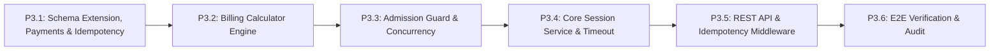

# BẢNG PHÂN RÃ CÔNG VIỆC TRIỂN KHAI PHA 3 (PHASE 3 IMPLEMENTATION TASKS - FINAL)
## THỨ TỰ PHỤ THUỘC KỸ THUẬT, TIỂU PHA VÀ TIÊU CHUẨN NGHIỆM THU

> [!NOTE]
> Tài liệu này chuẩn hóa toàn bộ 6 tiểu pha (Subphases) tuần tự, được sắp xếp nghiêm ngặt theo thứ tự phụ thuộc kỹ thuật. Mỗi tiểu pha đều định rõ mục tiêu, tệp tin tác động, quy tắc nghiệp vụ, bài kiểm thử tương ứng và tiêu chuẩn nghiệm thu độc lập.

---

## 1. TỔNG QUAN LỘ TRÌNH 6 TIỂU PHA TUẦN TỰ

---

## 2. CHI TIẾT TỪNG TIỂU PHA TRIỂN KHAI

### 🟢 TIỂU PHA P3.1: MỞ RỘNG CƠ SỞ DỮ LIỆU & PRISMA MIGRATION
- **Mục tiêu**: Bổ sung các trường Snapshot biểu phí, lũy kế thanh toán `paidAmount`, mô hình lịch sử thanh toán `ParkingSessionPayment`, mô hình `IdempotencyKey` và vết kiểm toán vào `schema.prisma`. Sinh migration mới an toàn trên PostgreSQL.
- **Tệp tin tác động**:
  - `backend/prisma/schema.prisma` (Chỉnh sửa)
  - `backend/prisma/migrations/202611..._parking_session_lifecycle/migration.sql` (Tạo mới)
- **Nội dung công việc**:
  1. Thêm các cột tài chính và kiểm toán trên `ParkingSession`.
  2. Tạo model `ParkingSessionPayment` với quan hệ $1 - N$ trỏ về `ParkingSession` và `User`.
  3. Tạo model `IdempotencyKey` lưu trữ key, hash payload, response cache và thời gian lock.
  4. Chạy `npx prisma migrate dev --name parking_session_lifecycle`.
- **Tiêu chuẩn nghiệm thu**:
  - Lược đồ CSDL hợp lệ 100%, 4 migrations tuyến tính.
  - 59 tests hiện tại tiếp tục PASS 100% (Zero regressions).
- **Ước lượng thời gian**: 1.5 – 2 giờ.

---

### 🟢 TIỂU PHA P3.2: ĐỘNG CƠ TÍNH PHÍ THUẦN TÚY (BILLING CALCULATOR ENGINE)
- **Mục tiêu**: Xây dựng module tính toán tiền cước thuần túy (Pure logic, không I/O), xử lý chính xác `Prisma.Decimal`, làm tròn giờ lên (`ceil`), áp dụng khung tối thiểu 1 giờ và snapshot biểu giá.
- **Tệp tin tác động**:
  - `backend/src/modules/billing/billing.types.ts` (Tạo mới)
  - `backend/src/modules/billing/billing.calculator.ts` (Tạo mới)
  - `backend/tests/billing-calculator.test.ts` (Tạo mới)
- **Nội dung công việc**:
  1. Hàm `calculateParkingFee(entryTime, cutoffTime, pricingType, rate)`: Trả về `durationMinutes`, `billableHours`, `totalFee`.
  2. Hàm `resolvePricingSnapshot(lotId, vehicleType, pricingType)`.
  3. Viết suite `billing-calculator.test.ts` (8 bài test).
- **Tiêu chuẩn nghiệm thu**: 8/8 tests đạt 100%, số học Decimal tuyệt đối chính xác.
- **Ước lượng thời gian**: 2 giờ.

---

### 🟢 TIỂU PHA P3.3: THUẬT TOÁN TIẾP NHẬN BẢO THỦ & KIỂM SOÁT ĐỒNG THỜI
- **Mục tiêu**: Hiện thực thuật toán sức chứa bảo thủ chống trừ trùng ô hỏng/bảo trì và ngăn ngừa race condition chỗ đỗ cuối cùng bằng giao dịch đơn nhất kết hợp khóa hàng bi quan (`SELECT FOR UPDATE`).
- **Tệp tin tác động**:
  - `backend/src/modules/parking-sessions/admission.service.ts` (Tạo mới)
  - `backend/tests/admission-capacity.test.ts` (Tạo mới)
  - `backend/tests/session-concurrency.test.ts` (Tạo mới)
- **Nội dung công việc**:
  1. Hiện thực hàm `executeConservativeAdmission(tx, parkingLotId)`.
  2. Khóa dòng bãi đỗ xe: `SELECT id FROM parking_lots WHERE id = $1 FOR UPDATE`.
  3. Tính toán $\text{SafeAvailableSpaces}$ đối chiếu 4 trạng thái ô đỗ rời nhau và tải phiên logic $N_{\text{logical}}$.
  4. Viết suite kiểm thử sức chứa và kiểm thử 10 request đồng thời khi còn 1 chỗ trống trên PostgreSQL thật.
- **Tiêu chuẩn nghiệm thu**:
  - Không có hiện tượng trừ trùng ô vừa hỏng vừa bảo trì.
  - 10 request đồng thời chỉ có ĐÚNG 1 request thành công, 9 request nhận lỗi 409 `PARKING_LOT_FULL`.
- **Ước lượng thời gian**: 2.5 – 3 giờ.

---

### 🟢 TIỂU PHA P3.4: DỊCH VỤ CỐT LÕI PHIÊN GỬI XE, ENTRY TIMEOUT & LỊCH SỬ THANH TOÁN
- **Mục tiêu**: Hiện thực toàn bộ vòng đời phiên gửi xe, xử lý Entry Timeout tranh chấp với passage confirmation, xử lý phụ thu quá giờ ân hạn không thu trùng tiền, an toàn thẻ vãng lai và quy trình cho xe ra khi mất thẻ (không thu phạt).
- **Tệp tin tác động**:
  - `backend/src/common/errors/error-codes.ts` (Bổ sung mã lỗi)
  - `backend/src/modules/parking-sessions/parking-session.types.ts` (Tạo mới)
  - `backend/src/modules/parking-sessions/parking-session.service.ts` (Tạo mới)
  - `backend/tests/session-lifecycle.test.ts` (Tạo mới)
- **Nội dung công việc**:
  1. Các phương thức: `requestEntry`, `confirmEntryPassage`, `cancelExpiredEntrySession`.
  2. Các phương thức thanh toán: `calculateFee`, `confirmPayment` (cập nhật `paidAmount`, thêm dòng vào `parking_session_payments`, tính `amountDue`).
  3. Phương thức xuất bãi: `manualExit` (hỗ trợ gọi từ `ACTIVE` và `PENDING_EXIT`, bắt buộc $\text{amountDue} == 0$, cấm từ `PENDING_ENTRY`/`COMPLETED`/`CANCELLED`).
  4. Xử lý xuất bãi cho xe mất thẻ: ghi nhận audit trail, thu cước giờ thực tế, không thu phụ phí phạt.
  5. Viết suite `session-lifecycle.test.ts`.
- **Tiêu chuẩn nghiệm thu**:
  - Xung đột Entry Timeout và Confirm Passage được giải quyết nguyên tử bằng khóa dòng.
  - Phụ thu quá hạn chỉ thu phần chênh lệch (`amountDue`), bảo toàn số tiền đã nộp trước đó.
- **Ước lượng thời gian**: 4 – 5 giờ.

---

### 🟢 TIỂU PHA P3.5: BỘ REST API CHO CMS & HẠ TẦNG IDEMPOTENCY TRÊN POSTGRESQL
- **Mục tiêu**: Xây dựng Middleware Idempotency trên bảng `idempotency_keys`, các Controller, Zod Schemas và Router cho 8 Endpoint CMS.
- **Tệp tin tác động**:
  - `backend/src/common/middleware/idempotency.middleware.ts` (Tạo mới)
  - `backend/src/modules/parking-sessions/parking-session.validation.ts` (Tạo mới)
  - `backend/src/modules/parking-sessions/parking-session.controller.ts` (Tạo mới)
  - `backend/src/modules/parking-sessions/parking-session.router.ts` (Tạo mới)
  - `backend/src/app.ts` (Gắn route `/api/parking-sessions`)
  - `backend/tests/idempotency.test.ts` (Tạo mới)
  - `backend/tests/manual-operations-api.test.ts` (Tạo mới)
- **Nội dung công việc**:
  1. Middleware `enforceIdempotency`: Kiểm tra key, so khớp requestHash, trả về cache nếu replay, khóa cạnh tranh đồng thời.
  2. Viết 8 REST Endpoints quản lý phiên.
  3. Viết test suites `idempotency.test.ts` và `manual-operations-api.test.ts`.
- **Tiêu chuẩn nghiệm thu**:
  - 8/8 endpoints CMS hoạt động chuẩn xác, có xác thực JWT.
  - Gửi trùng request cùng Idempotency-Key trả lại kết quả 200/201 mà không làm thay đổi trạng thái CSDL.
- **Ước lượng thời gian**: 3 – 4 giờ.

---

### 🟢 TIỂU PHA P3.6: SEED DỮ LIỆU, KIỂM THỬ E2E HỒI QUY & BIÊN BẢN NGHIỆM THU
- **Mục tiêu**: Cập nhật seed script dữ liệu phiên mẫu, chạy toàn bộ suite kiểm thử tự động, xác minh hồi quy Frontend và lập báo cáo nghiệm thu kỹ thuật.
- **Tệp tin tác động**:
  - `backend/prisma/seed.ts` (Cập nhật)
  - `docs/audits/PHASE_3_BUILD_REPORT.md` (Tạo mới khi hoàn tất lập trình)
- **Nội dung công việc**:
  1. Cập nhật seed data với các phiên đỗ mẫu (có lịch sử thanh toán).
  2. Chạy toàn bộ kiểm thử: `npm run typecheck`, `npm run lint`, `npm run test`, `npm run build`.
  3. Kiểm tra hồi quy giao diện Frontend.
  4. Lập báo cáo kiểm định kỹ thuật Pha 3.
- **Tiêu chuẩn nghiệm thu**:
  - Toàn bộ ~95 tests của dự án đạt 100% (Zero regressions).
  - 0 TypeScript errors, 0 ESLint warnings.
- **Ước lượng thời gian**: 1.5 – 2 giờ.

---

## 3. TỔNG HỢP ƯỚC LƯỢNG THỜI GIAN VÀ TIẾN ĐỘ

| Tiểu pha | Trọng tâm công việc | Thời gian ước tính |
| :--- | :--- | :---: |
| **P3.1** | Schema Extension, Payments & Idempotency Table | 1.5 – 2.0 giờ |
| **P3.2** | Động cơ Tính phí Billing Calculator Engine | 2.0 giờ |
| **P3.3** | Thuật toán Sức chứa Bảo thủ & Concurrency | 2.5 – 3.0 giờ |
| **P3.4** | Dịch vụ Cốt lõi Phiên, Entry Timeout & Lịch sử Thu tiền | 4.0 – 5.0 giờ |
| **P3.5** | Bộ REST API CMS & Idempotency Middleware | 3.0 – 4.0 giờ |
| **P3.6** | Seed Dữ liệu, Kiểm thử E2E Hồi quy & Báo cáo Nghiệm thu | 1.5 – 2.0 giờ |
| **TỔNG CỘNG** | **Toàn bộ Pha 3** | **~14.5 – 18.0 giờ làm việc tập trung** |
