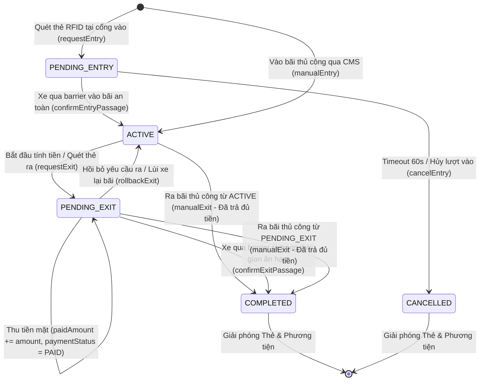
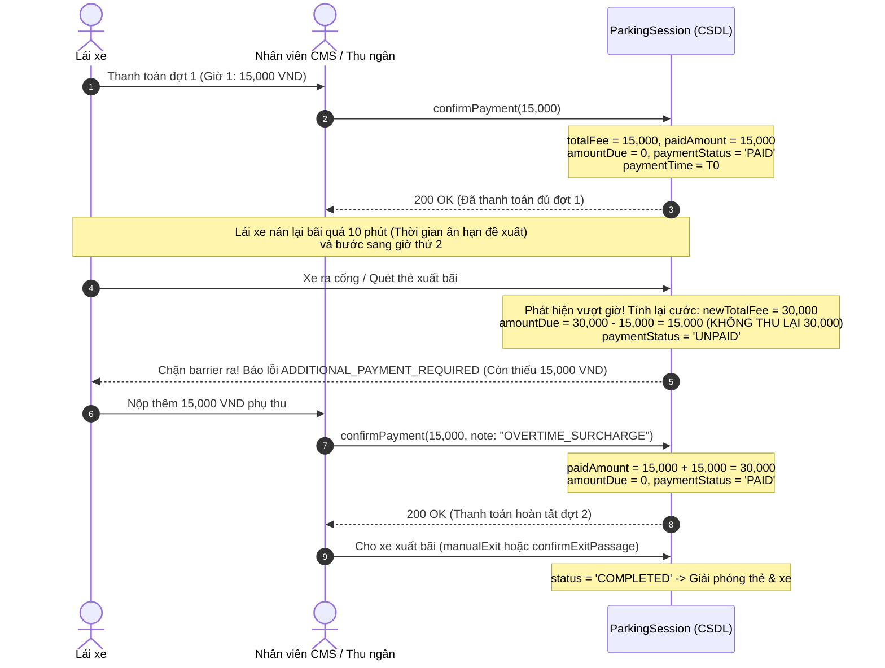

# THIẾT KẾ MÁY TRẠNG THÁI PHIÊN GỬI XE (PARKING SESSION STATE MACHINE - FINAL)
## CHU KỲ TRẠNG THÁI, TIMEOUT PHIÊN VÀO, PHỤ THU QUÁ GIỜ & AN TOÀN VẬN HÀNH

> [!NOTE]
> Tài liệu này chuẩn hóa toàn bộ chu kỳ trạng thái của một phiên gửi xe (`ParkingSession`), phân giải xung đột giữa Entry Timeout và Passage Confirmation, quy tắc phụ thu quá hạn và rào chắn bảo vệ chuyển dịch trạng thái.

---

## 1. MÔ HÌNH CHUYỂN DỊCH TRẠNG THÁI TỔNG THỂ



---

## 2. PHÂN GIẢI XUNG ĐỘT ENTRY TIMEOUT VÀ CONFIRM PASSAGE

Khi xe quẹt thẻ tại cổng vào, phiên ở trạng thái `PENDING_ENTRY`.
- **Thời hạn chờ**: Mặc định **60 giây** (`ENTRY_TIMEOUT_SECONDS = 60`).
- **Tình huống xung đột (Race Condition)**: Xe thực tế chạy qua barrier tại giây thứ 59.9, trong khi tác vụ quét dọn Timeout chạy tại giây thứ 60.0.

### Cơ chế Tuần tự hóa Giao dịch:
Cả hai tác vụ đều bắt buộc thực hiện trong một giao dịch có khóa hàng bi quan:
```sql
SELECT id, status FROM "parking_sessions" WHERE id = $1 FOR UPDATE;
```
1. **Trường hợp `confirmEntryPassage` giành được khóa trước**:
   - Cập nhật `status = 'ACTIVE'`. Commit!
   - Khi tác vụ Timeout giành được khóa sau, nó đọc thấy `status !== 'PENDING_ENTRY'` $\rightarrow$ **Bỏ qua, không hủy phiên**.
2. **Trường hợp Timeout giành được khóa trước**:
   - Cập nhật `status = 'CANCELLED'`, `cancelReason = 'ENTRY_TIMEOUT_EXPIRED'`. Commit!
   - Khi `confirmEntryPassage` giành được khóa sau, nó đọc thấy `status === 'CANCELLED'` $\rightarrow$ **Từ chối xác nhận và ném lỗi `SESSION_ALREADY_CANCELLED`**. Barrier không mở.

---

## 3. QUY TRÌNH PHỤ THU QUÁ HẠN ÂN HẠN KHÔNG THU TRÙNG TIỀN



---

## 4. MA TRẬN QUY TẮC CHUYỂN ĐỔI BẤT BIẾN (STATE INVARIANTS)

1. **Quy tắc Ra bãi Thủ công (`manualExit`)**:
   - **HỢP LỆ**: Chỉ được phép gọi từ `ACTIVE` và `PENDING_EXIT`.
   - **BỊ CẤM**: Tuyệt đối từ chối nếu phiên đang ở `PENDING_ENTRY`, `COMPLETED`, `CANCELLED` (Trả về 400 `INVALID_SESSION_STATE_TRANSITION`).
   - **Điều kiện hoàn thành**: Bắt buộc có xác nhận rời bãi (`vehicleDepartedConfirmed: true`) VÀ $\text{amountDue} == 0$ (hoặc `paymentStatus === 'EXEMPT'`).
2. **An toàn Thẻ RFID Vãng lai**:
   - Thẻ bị khóa trong partial unique index suốt các trạng thái `PENDING_ENTRY`, `ACTIVE`, `PENDING_EXIT`.
   - Thẻ **CHỈ ĐƯỢC GIẢI PHÓNG** khi phiên chuyển sang `COMPLETED` hoặc `CANCELLED`.
3. **Chống Ghi đè Trạng thái do Request Lặp (Idempotency State Guard)**:
   - Nếu gọi lại `confirmPayment` với cùng số tiền trên phiên đã thanh toán $\rightarrow$ Trả về 200 OK (no-op).
   - Nếu gọi lại `confirmEntryPassage` trên phiên đã `ACTIVE` $\rightarrow$ Trả về 200 OK (no-op).
   - Không cho phép bất kỳ request nào làm suy đồi (corrupt) trạng thái của phiên.
